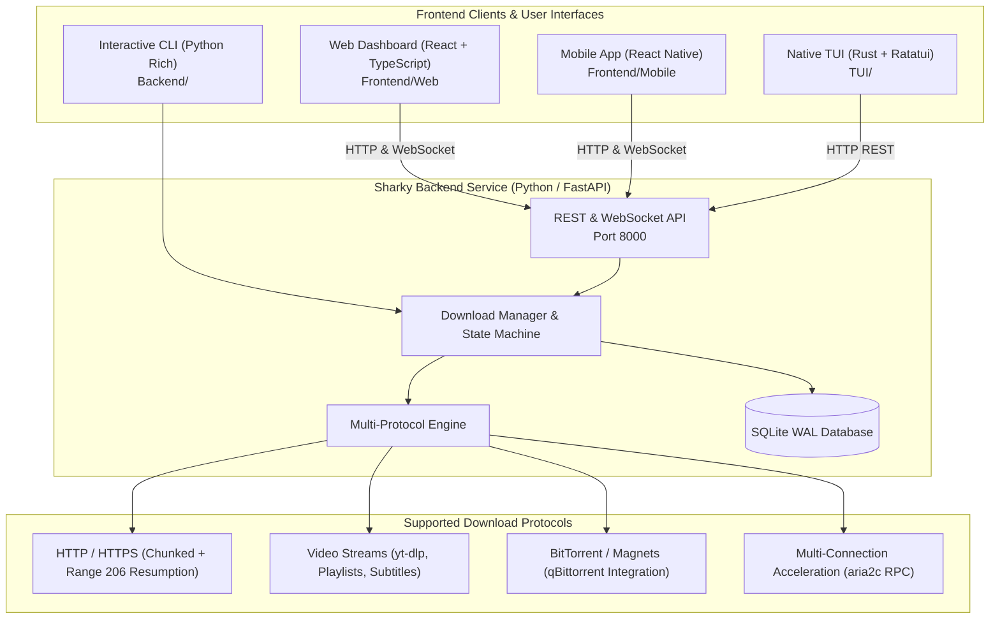

# Sharky 🦈

> Modern, High-Performance, Multi-Client Distributed Download Engine.

**Sharky** is a full-stack download manager designed for speed, reliability, and ubiquity. It combines an asynchronous multi-protocol backend engine with multiple user interface frontends: a modern **React Web Dashboard**, a **React Native Mobile App**, a native **Rust TUI**, and a built-in **Python CLI**.



---

## Repository Structure

```
Sharky/
├── Backend/                 # Core Python engine & FastAPI backend service
│   ├── download_manager/    # Modular engine (downloaders, database, models)
│   ├── tests/               # Automated unit & integration test suite (22 tests)
│   ├── run.py               # Backend runner (server, cli, tui modes)
│   ├── requirements.txt     # Python dependencies
│   └── Dockerfile           # Backend container build
├── Frontend/
│   ├── Web/                 # React 19 + TypeScript + Vite web dashboard
│   └── Mobile/              # React Native / Expo mobile application
├── TUI/                     # Ultra-fast Rust Terminal User Interface (Ratatui)
├── docker-compose.yml       # Monorepo container orchestration
├── run.py                   # Root launcher forwarder
└── README.md
```

---

## Features

- **Multi-Protocol Acceleration**: Seamlessly handles direct HTTP/HTTPS downloads, video/audio extraction (via `yt-dlp`), BitTorrent/Magnet links (via `qBittorrent`), and accelerated multi-segment downloads (via `aria2c`).
- **Resilient Range Resumption**: Accurate `206 Partial Content` detection preventing corruption or file bloat on interrupted transfers.
- **Bandwidth Throttling**: Granular speed limit configurations (`DOWNLOAD_SPEED_LIMIT`) applied across all download providers.
- **Automated Checksum Verification**: Cryptographic integrity validation supporting SHA-256, MD5, and SHA-1 upon completion.
- **Batch Import**: Ingest dozens or hundreds of URLs at once via file import (CLI) or REST API (`/api/downloads/batch`).
- **Real-Time WebSocket Feeds**: Live byte counters, speeds, progress percentages, and ETAs broadcasted to all connected frontends.
- **Thread-Safe SQLite State**: WAL mode and 5,000ms busy timeouts ensuring rock-solid multi-threaded persistence.

---

## Getting Started

### 1. Backend Service (Python / FastAPI)

#### Native Run
```bash
# Install dependencies
pip install -r Backend/requirements.txt

# Start the REST & WebSocket backend server (Port 8000)
python run.py server

# Or run the interactive terminal CLI
python run.py
```

#### Run with Docker Compose
```bash
docker compose up -d
```
The API server and Swagger documentation will be available at:
- **API Base**: `http://localhost:8000`
- **Interactive API Docs**: `http://localhost:8000/docs`

---

### 2. Frontend Web Dashboard (React + TypeScript)

```bash
cd Frontend/Web

# Install dependencies
npm install

# Start development server
npm run dev
```
Open `http://localhost:5173` to access the live dashboard with real-time download tracking and controls.

---

### 3. Frontend Mobile App (React Native / Expo)

```bash
cd Frontend/Mobile

# Install dependencies
npm install

# Start Expo dev server
npx expo start
```

---

### 4. Rust Terminal User Interface (TUI)

```bash
cd TUI

# Run the native TUI (connects to http://localhost:8000)
cargo run
```

---

## Running the Automated Test Suite

Run the full pytest automated test suite across all downloaders, database concurrency, and API endpoints:

```bash
cd Backend
python3 -m pytest tests/ -v
```
All 22 unit & integration tests pass with 100% coverage across core components.

---

## License
MIT License.
